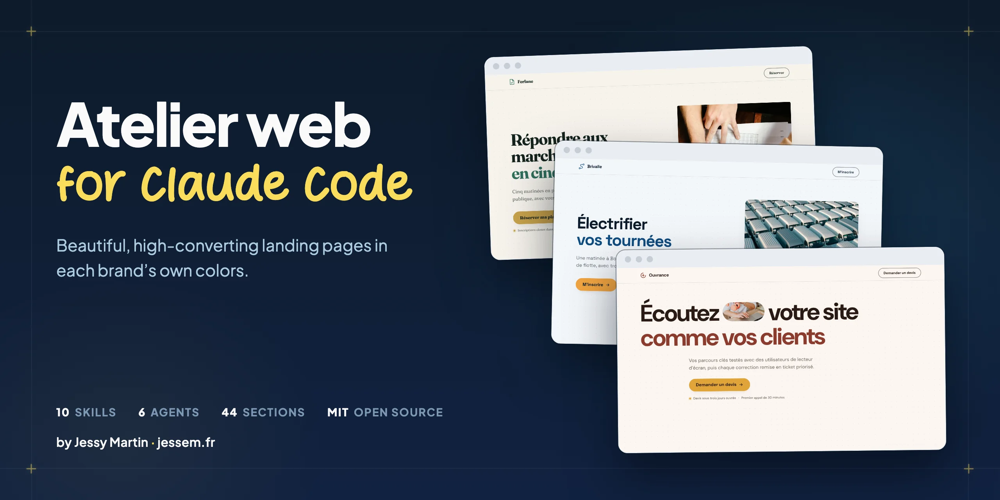
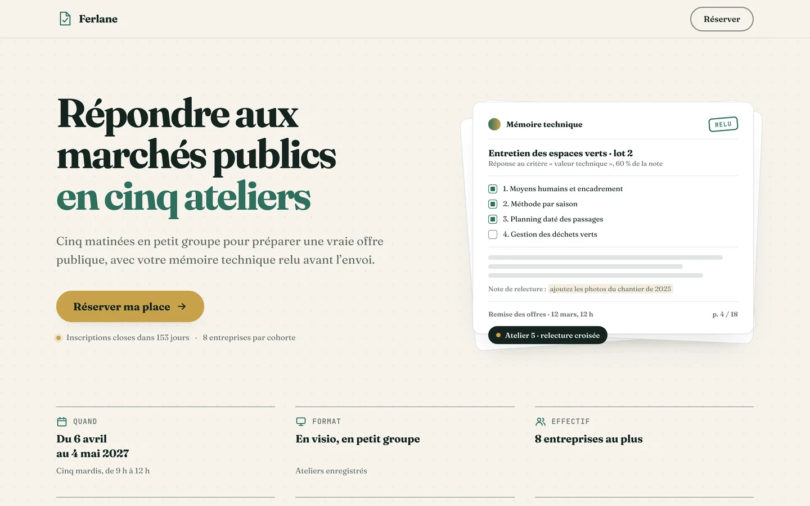
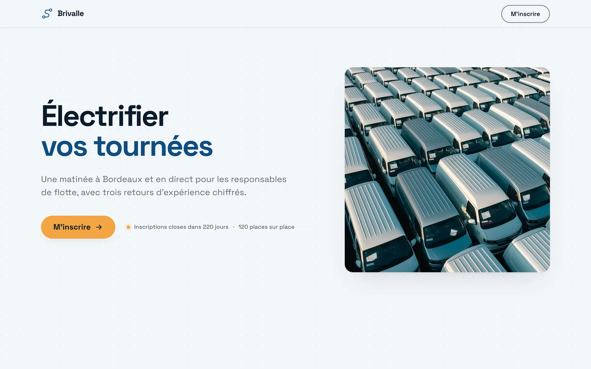
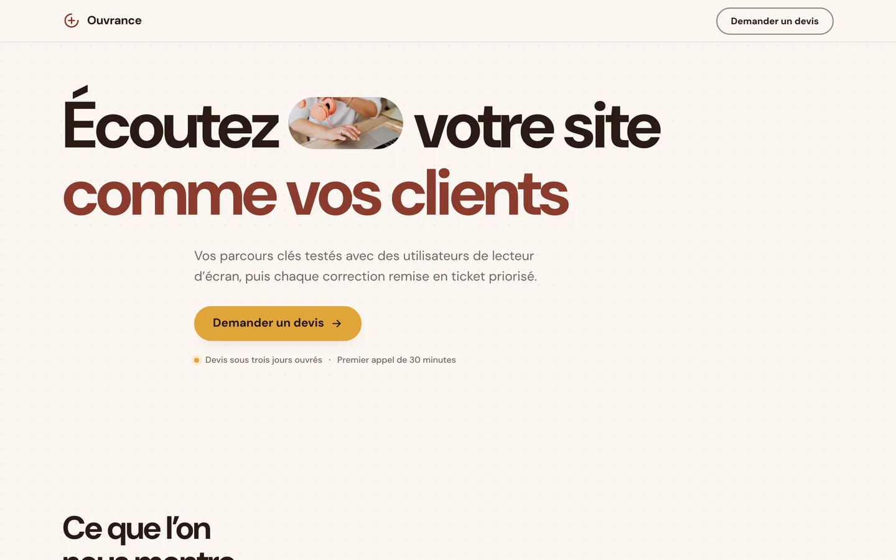

# Atelier web for Claude Code

**English** · [Français](README.fr.md)

[](LICENSE)    



**Atelier web is a Claude Code plugin for designing and building beautiful, high-converting landing pages and web pages that look exactly like the brand they serve.** It bundles 10 skills, 7 agents (visual research, parallel section builders, design, brand, conversion and accessibility reviewers), a library of 44 proven landing sections, and a QA step that measures the real render before showing you anything.

It packages the method I use to build my clients’ websites and landing pages. I'm [Jessy Martin](https://jessem.fr/en/), a French consultant and trainer who helps marketing teams work with Claude Code and AI agents.

> The skills are written in French. Claude builds your pages in any language you ask for.

## The problem it solves

Claude Code can build a page in minutes. Left alone, it tends to build the same page every time: a purple gradient, stacked white cards, a default font, made-up numbers, and a render that never gets checked on a phone before it ships.

Atelier web changes three things:

1. **Brand first.** Each project writes its brand doctrine once (colors, fonts, voice, allowed proof points, site components), and every skill reads it before producing anything. Pages look like the site they join.
2. **A method tested on real pages.** Scoping in one round of questions, visual directions named after their signature object, the hero approved first, sections built in parallel, four specialized reviews, then one arbitrated round of fixes.
3. **Measured QA.** Horizontal overflow, contrast, text size floors, a call to action visible without scrolling on mobile, background continuity between sections, reduced motion: all measured at three screen sizes before you see the page.

## One factory for every brand

The three pages below come out of the same commands with three different brand doctrines. The brands are fictional.

| Training | Event | Service |
|---|---|---|
|  |  |  |
| [Live demo](https://littlpinguin.github.io/atelier-web/demo/ferlane/) | [Live demo](https://littlpinguin.github.io/atelier-web/demo/brivalle/) | [Live demo](https://littlpinguin.github.io/atelier-web/demo/ouvrance/) |

Browse all 44 sections in the [live catalogue](https://littlpinguin.github.io/atelier-web/catalogue/).

## Install

Requirements: [Claude Code](https://claude.com/claude-code) (desktop app or terminal), Python 3.11+, and for rendering QA `pip install playwright pillow pyyaml && playwright install chromium`.

```bash
claude plugin marketplace add Littlpinguin/atelier-web
```

```bash
claude plugin install atelier-web@atelier-web
```

Restart Claude Code. To add the plugins I use alongside it (UI/UX Pro Max, frontend-design, superpowers, and optionally GSAP, Three.js, SEO and Figma), run `./outils-complementaires/installer.sh` from a clone of this repository (details in [`outils-complementaires/README.md`](outils-complementaires/README.md), in French).

**For a team**: add [`outils-complementaires/settings-projet.json`](outils-complementaires/settings-projet.json) to the project's `.claude/settings.json` and commit it. Everyone gets the plugin when they open the folder.

## Quick start

1. Open Claude Code in your website's folder.
2. Run `/atelier-web:demarrer-projet-web`: Claude reads your site and your content, drafts the brand doctrine, has you approve it block by block, and writes it to `atelier/marque/`.
3. Run `/atelier-web:landing-page` for a landing page, `/atelier-web:page-web` for a page or section on an existing site, or `/atelier-web:design` to modernize a site that looks dated.

Every deliverable goes through `revue` (rendering QA) and `brand-check` before you see it.

## What's inside

| Family | Skills |
|---|---|
| Start | `demarrer-projet-web`: project brand doctrine and routing |
| Build a page | `landing-page` (8-phase playbook), `page-web` (existing site), `lead-magnet` (tool or guide in exchange for an email) |
| Design | `design`: directions named by their signature object, an execution protocol against the generated look, redesign of an existing site, design tokens |
| Motion | `motion`: native CSS scroll-driven animations first, GSAP for pinning, anime.js, dotLottie for animated media |
| Conversion | `cro`: pages, forms, popups, pricing |
| Copy | `ecriture`: write, review in seven passes, humanize text that sounds generated |
| Quality | `revue` (measured rendering, interface review, WCAG 2.2 AA accessibility), `brand-check` |

Each skill keeps its detail in reference files one level below its `SKILL.md`, read only when the task needs them.

**Agents**: `landing-researcher` (benchmark and visual research in the background), `landing-section-builder` (one section per agent, in parallel), `landing-reviewer-design`, `landing-reviewer-brand`, `landing-reviewer-cro`, `landing-reviewer-a11y`, and `a11y-auditor` (accessibility on the real render).

**Factory**: 44 sections (hero, proof, program, offer, FAQ, choice gate, comparison and more), 6 landing page templates (training, event, service, B2B demo, long-form sales, lead capture), 10 interactive lead magnets (ROI calculator, scored diagnostic, quiz and more), and the scripts `assemble-landing.py`, `qa-landing.py`, `controle-fonds.py`, `build-tokens.py`, `lint-brand.py`. A hook runs the brand linter after every page Claude writes, including pages assembled by a script.

**Evals**: `plugins/atelier-web/evals/` holds a `claude plugin eval` suite (routing, skill triggering, requests that must not trigger, one end-to-end landing page), run against a fictional brand doctrine provided as a fixture.

The full method (in French) is in [`docs/methode.md`](docs/methode.md).

## FAQ

**Do I need to know how to code?**
For everyday use, you can do without it: you describe the page, approve the direction and review the render. Reading HTML helps if you want to go further.

**Does it work with Next.js, Astro or WordPress?**
The factory outputs self-contained HTML pages, ready for a static site. In a framework, the assembled page acts as a faithful mockup, then gets ported to components with the same design tokens. The design, conversion and review skills apply to any stack.

**How is it different from frontend-design or UI/UX Pro Max?**
Both are excellent, and Atelier web includes adapted parts of them (see [`CREDITS.md`](CREDITS.md)). frontend-design gives an aesthetic direction; UI/UX Pro Max gives a database of styles, palettes and rules. Atelier web adds a per-project brand doctrine, an end-to-end method with specialized agents, a section library and measured QA. They work well together, and the installer sets them up side by side.

**Is it free?**
Yes, under the MIT license. If you want your team trained on it, I run a course on [building web pages with Claude](https://jessem.fr/en/training/build-web-pages-with-claude/).

**Does my data go anywhere?**
The plugin has no remote service: scripts run on your machine, and your brand doctrine stays in your project.

## About

I'm Jessy Martin. I help marketing teams adopt Claude Code and AI agents through consulting and training, and I teach at Clermont School of Business. Atelier web comes from the pages I build for clients and from my own website, [jessem.fr](https://jessem.fr/en/).

- Training: [build web pages with Claude, from brief to publication](https://jessem.fr/en/training/build-web-pages-with-claude/)
- Method: [how to build a website with Claude Code](https://jessem.fr/en/blog/build-website-with-claude-code)
- Other open projects: [marketing-cockpit-template](https://github.com/Littlpinguin/marketing-cockpit-template) (a marketing department inside Claude Code, which Atelier web is extracted from), [claude-site-starter](https://github.com/Littlpinguin/claude-site-starter) (a static website starter)
- [LinkedIn](https://www.linkedin.com/in/jessy-martin/)

## Update

```bash
claude plugin marketplace update atelier-web
```

```bash
claude plugin update atelier-web@atelier-web
```

Updates never touch your projects' brand doctrine.

## License

MIT. Content adapted from third-party projects keeps its license and attribution: see [`CREDITS.md`](CREDITS.md).
